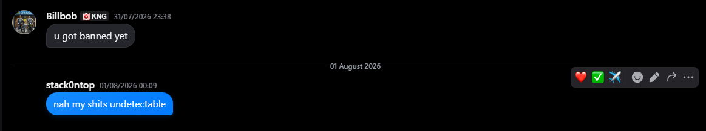
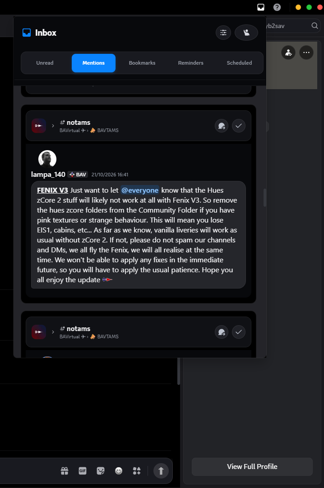
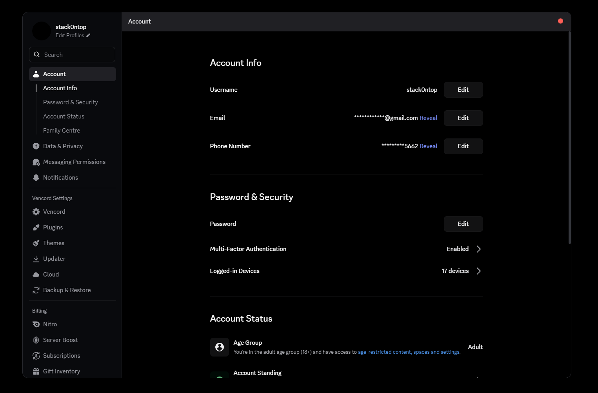

# iMessage Dark + Big Sur 3.0

A custom Discord QuickCSS theme inspired by Apple's **iMessage** and **macOS Big Sur** design language.

This theme brings rounded chat bubbles, a dark interface, macOS-inspired window controls, and iMessage-style visual details to Discord, with additional styling for the Inbox and unread message notifications.

> **Compatibility:** Designed for Discord with Vencord and QuickCSS. Discord updates may change internal class names and require CSS adjustments.

## Features

- **iMessage-inspired chat bubbles** — blue outgoing bubbles and dark incoming bubbles.
- **Dark appearance** — charcoal surfaces and black backgrounds inspired by Apple's dark interface.
- **macOS Big Sur styling** — macOS-inspired window controls and interface details.
- **Custom message styling** — rounded corners, refined spacing, and typography adjustments.
- **Inbox customisation** — styled Inbox header, navigation tabs, and action buttons.
- **Unread message styling** — custom notification containers, avatar alignment, and message bubbles.
- **Embed styling** — rounded embed cards, blue accent borders, and image adjustments.
- **Custom interface details** — tailored icons, buttons, hover effects, and other visual refinements.

Features may vary depending on your Discord client version and the CSS selectors currently used by the theme.

## Preview

Add screenshots or GIFs of the theme here.

Suggested screenshots:
- Main Discord chat
- Incoming and outgoing message bubbles
- Inbox header and tabs
- Unread messages and embedded content

Example:

## Requirements

- [Discord](https://discord.com/)
- [Vencord](https://vencord.dev/)
- QuickCSS enabled in Vencord settings

This is a CSS customisation, not a standalone Discord client or plugin.

## Installation

1. Install Vencord from the official website.
2. Open Discord and navigate to **User Settings**.
3. Find **Vencord → Themes → QuickCSS** (the location may vary by version).
4. Open the QuickCSS editor.
5. Copy the contents of the theme's `.css` file into the editor.
6. Save your changes and reload Discord if necessary.

### Updating

When updating the theme, replace the previous CSS with the latest version from this repository. Avoid keeping multiple copies of the same rules, as duplicate selectors can cause unexpected styling conflicts.

## Configuration

The theme uses CSS overrides and may require occasional adjustments.

You can customise:
- Bubble colours
- Border radius
- Avatar size and spacing
- Background colours
- Embed appearance
- Inbox spacing and button styling

Some selectors are generated by Discord and may change after client updates. If an element stops looking correct, check the relevant selectors and review any conflicting QuickCSS rules.

## Compatibility and limitations

- This theme is intended for use with Vencord's QuickCSS feature.
- It is not an official Apple, Discord, or Vencord product.
- Discord's internal CSS class names can change without notice.
- Certain Inbox and unread-notification styles may require maintenance after Discord updates.
- Appearance may differ depending on Discord experiments, client layout, and other installed themes or CSS snippets.

## Credits and acknowledgements

- **Apple** — design inspiration from iMessage and macOS Big Sur.
- **Discord** — the platform being customised.
- **Vencord** — the client modification that enables custom CSS.

This project is an independent community-made theme and is not affiliated with, endorsed by, or sponsored by Apple, Discord, or Vencord.

## Copyright and licence

Copyright © 2026. All rights reserved.

Unless explicitly stated otherwise, the original CSS, theme-specific styling, documentation, and other original assets in this repository are the intellectual property of the repository's author.

**You may not redistribute, republish, sell, sublicense, or create derivative distributions of this theme without prior written permission from the copyright holder.** Personal use and local modifications for personal use are permitted.

Third-party trademarks, names, and logos remain the property of their respective owners.

This notice applies only to material owned by the author and does not claim ownership of Discord, Vencord, Apple, or other third-party intellectual property.

For permission requests, contact the repository owner through GitHub.

## Disclaimer

This project is provided "as is", without warranties of any kind. The author is not responsible for issues caused by Discord updates, incompatible CSS modifications, or other client customisations.

Use of this theme does not modify or replace Discord's official terms or policies.

---

**Enjoy the iMessage-inspired Discord experience.**
